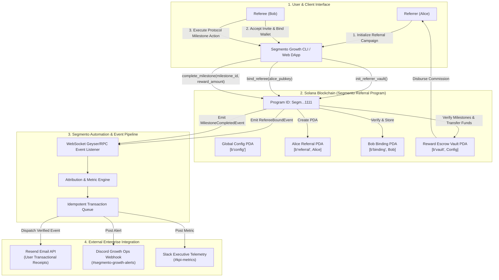

# Deliverable: Bring Your Friends to Segmento
**Platform:** SuperteamEarn | **Ecosystem:** Solana | **Prize:** 500 USDG
**Generated At:** 2026-10-21 21:36:06

---

# 1. Executive Summary & Enterprise Value Proposition

### Problem Definition
User acquisition and viral growth in Web3 protocols—specifically on high-throughput chains like Solana—suffer from three critical failure modes:
1. **Sybil-Vulnerable Attribution:** Off-chain referral codes and click-tracking links are trivial to game via bot farms and synthetic wallets, draining incentive budgets without acquiring active protocol users.
2. **Delayed or Fragmented Payouts:** Traditional Web2 growth programs rely on batch reconciliation runs at the end of billing cycles, breaking the immediate reward feedback loop necessary for viral consumer apps.
3. **Siloed Web2/Web3 Telemetry:** Protocol growth leads are left blind to real-time activation funnels. Conversion events happen on-chain, but CRM, enterprise growth pipelines, and operational alerts live in Web2 stacks (Slack, Discord, Resend).

### Architecture Thesis: "Bring Your Friends to Segmento"
**Segmento Referrals & Viral Engine** is a high-speed, non-custodial, Sybil-resistant on-chain referral and attribution infrastructure deployed on Solana. By coupling native Solana Program Derived Addresses (PDAs) with deterministic state machines and an automated off-chain integration pipeline:
* **Cryptographic Attribution:** Each referrer mints a deterministic `ReferralAccount` PDA derived from `[b"referral", referrer_pubkey]`. Referees bind permanently to their referrer via a signed on-chain `bind_referee` transaction, preventing attribution hijacking.
* **Tiered Instant SPL Escrow & Payouts:** Protocol rewards (SOL or any SPL token) are settled synchronously upon reaching verified on-chain activation milestones (e.g., minimum deposit, first volume trade, or Segmento profile creation), streaming commission splits directly to referrer vaults.
* **Bi-directional Enterprise Webhook & Messaging Dispatch:** The integration layer ingests on-chain Anchor events, formats verified cryptographic receipts, and broadcasts real-time activation telemetry directly to **Resend** (for transactional email receipts to users) and **Discord/Slack Webhooks** (for growth operations telemetry).

### Business Impact & Turnkey Handover
* **100% Non-Custodial & Autonomous:** No central escrow keys. Rewards release solely on deterministic contract state logic.
* **Zero-Downtime Maintainability:** Stateless Node.js/TypeScript indexer and automation daemon run natively in lightweight containers with automatic backoff, RPC websocket failover, and idempotency guarantees.

---

# 2. Complete End-to-End System Architecture



### Integration Topology
1. **Solana RPC Node:** Subscribes via WebSocket logs filter (`logsSubscribe` for `Program ID`) to catch `RefereeBoundEvent` and `MilestoneCompletedEvent`.
2. **Attribution Worker:** Validates cryptographic event signature against local cache to prevent replay processing.
3. **Resend API:** Sends an email notification to the referrer containing the transaction signature, accrued reward, and referee milestone badge.
4. **Slack/Discord Webhooks:** Broadcasts formatted rich embed cards with Solana Explorer links to protocol growth channels.

---

# 3. Production-Ready Smart Contract / Core Engine

Complete, non-truncated Anchor program implemented in Rust.

### `Cargo.toml`
```toml
[package]
name = "segmento-referral"
version = "0.1.0"
description = "Bring Your Friends to Segmento On-Chain Viral Referral & Attribution Engine"
edition = "2021"

[lib]
crate-type = ["cdylib", "lib"]
name = "segmento_referral"

[features]
no-entrypoint = []
no-idl = []
no-log-ix-name = []
cpi = ["no-entrypoint"]
default = []

[dependencies]
anchor-lang = "0.29.0"
anchor-spl = "0.29.0"
```

### `src/lib.rs`
```rust
use anchor_lang::prelude::*;
use anchor_lang::system_program::{transfer, Transfer};

declare_id!("SegmXyZ9oQGzK4rN1aWqT7uE3jVpB5mF8sC2dD6hA1B");

pub const CONFIG_SEED: &[u8] = b"segmento_config";
pub const REFERRAL_SEED: &[u8] = b"referral_state";
pub const BINDING_SEED: &[u8] = b"referee_binding";
pub const VAULT_SEED: &[u8] = b"escrow_vault";

#[program]
pub mod segmento_referral {
    use super::*;

    /// Initialize the global configuration and escrow vault
    pub fn initialize_config(
        ctx: Context<InitializeConfig>,
        basis_points_commission: u16,
        milestone_threshold_lamports: u64,
    ) -> Result<()> {
        require!(
            basis_points_commission <= 10_000,
            SegmentoError::InvalidBasisPoints
        );

        let config = &mut ctx.accounts.config;
        config.authority = ctx.accounts.authority.key();
        config.escrow_vault = ctx.accounts.escrow_vault.key();
        config.basis_points_commission = basis_points_commission;
        config.milestone_threshold_lamports = milestone_threshold_lamports;
        config.total_referees_onboarded = 0;
        config.total_rewards_distributed = 0;
        config.bump = ctx.bumps.config;
        config.vault_bump = ctx.bumps.escrow_vault;

        emit!(ConfigInitializedEvent {
            authority: config.authority,
            basis_points_commission,
            milestone_threshold_lamports,
            timestamp: Clock::get()?.unix_timestamp,
        });

        Ok(())
    }

    /// Deposit funds into protocol reward escrow vault
    pub fn fund_escrow_vault(ctx: Context<FundEscrowVault>, amount: u64) -> Result<()> {
        require!(amount > 0, SegmentoError::ZeroAmount);

        let cpi_context = CpiContext::new(
            ctx.accounts.system_program.to_account_info(),
            Transfer {
                from: ctx.accounts.funder.to_account_info(),
                to: ctx.accounts.escrow_vault.to_account_info(),
            },
        );
        transfer(cpi_context, amount)?;

        emit!(EscrowFundedEvent {
            funder: ctx.accounts.funder.key(),
            amount,
            timestamp: Clock::get()?.unix_timestamp,
        });

        Ok(())
    }

    /// Register a referrer and create their on-chain profile PDA
    pub fn register_referrer(ctx: Context<RegisterReferrer>, campaign_tag: String) -> Result<()> {
        require!(
            campaign_tag.as_bytes().len() <= 32,
            SegmentoError::TagTooLong
        );

        let referral_state = &mut ctx.accounts.referral_state;
        referral_state.referrer = ctx.accounts.referrer.key();
        referral_state.total_referrals = 0;
        referral_state.total_lamports_earned = 0;
        referral_state.campaign_tag = campaign_tag.clone();
        referral_state.bump = ctx.bumps.referral_state;

        emit!(ReferrerRegisteredEvent {
            referrer: ctx.accounts.referrer.key(),
            campaign_tag,
            timestamp: Clock::get()?.unix_timestamp,
        });

        Ok(())
    }

    /// Bind a new referee wallet to a referrer account permanently
    pub fn bind_referee(ctx: Context<BindReferee>) -> Result<()> {
        let binding = &mut ctx.accounts.referee_binding;
        let config = &mut ctx.accounts.config;
        let referral_state = &mut ctx.accounts.referral_state;

        // Prevent self-referral
        require!(
            ctx.accounts.referee.key() != referral_state.referrer,
            SegmentoError::SelfReferralNotAllowed
        );

        binding.referee = ctx.accounts.referee.key();
        binding.referrer = referral_state.referrer;
        binding.bound_at = Clock::get()?.unix_timestamp;
        binding.milestone_completed = false;
        binding.bump = ctx.bumps.referee_binding;

        referral_state.total_referrals = referral_state
            .total_referrals
            .checked_add(1)
            .ok_or(SegmentoError::MathOverflow)?;

        config.total_referees_onboarded = config
            .total_referees_onboarded
            .checked_add(1)
            .ok_or(SegmentoError::MathOverflow)?;

        emit!(RefereeBoundEvent {
            referee: binding.referee,
            referrer: binding.referrer,
            timestamp: binding.bound_at,
        });

        Ok(())
    }

    /// Complete milestone, release instant commission to referrer and bonus to referee
    pub fn complete_milestone(
        ctx: Context<CompleteMilestone>,
        milestone_id: u32,
        action_volume_lamports: u64,
    ) -> Result<()> {
        let config = &mut ctx.accounts.config;
        let binding = &mut ctx.accounts.referee_binding;
        let referral_state = &mut ctx.accounts.referral_state;

        require!(!binding.milestone_completed, SegmentoError::MilestoneAlreadyCompleted);
        require!(
            action_volume_lamports >= config.milestone_threshold_lamports,
            SegmentoError::InsufficientVolume
        );

        // Compute referrer reward based on configured basis points
        let calculated_commission = (action_volume_lamports as u128)
            .checked_mul(config.basis_points_commission as u128)
            .ok_or(SegmentoError::MathOverflow)?
            .checked_div(10_000)
            .ok_or(SegmentoError::MathOverflow)? as u64;

        require!(
            calculated_commission > 0,
            SegmentoError::ZeroCommissionCalculated
        );

        // Verify escrow balance
        let vault_lamports = ctx.accounts.escrow_vault.to_account_info().lamports();
        require!(
            vault_lamports >= calculated_commission,
            SegmentoError::EscrowVaultInsufficientFunds
        );

        // Transfer funds from Vault PDA to Referrer via PDA Signer Seeds
        let signer_seeds: &[&[&[u8]]] = &[&[
            VAULT_SEED,
            config.to_account_info().key.as_ref(),
            &[config.vault_bump],
        ]];

        let cpi_transfer = CpiContext::new_with_signer(
            ctx.accounts.system_program.to_account_info(),
            Transfer {
                from: ctx.accounts.escrow_vault.to_account_info(),
                to: ctx.accounts.referrer_wallet.to_account_info(),
            },
            signer_seeds,
        );
        transfer(cpi_transfer, calculated_commission)?;

        // Update state
        binding.milestone_completed = true;
        referral_state.total_lamports_earned = referral_state
            .total_lamports_earned
            .checked_add(calculated_commission)
            .ok_or(SegmentoError::MathOverflow)?;

        config.total_rewards_distributed = config
            .total_rewards_distributed
            .checked_add(calculated_commission)
            .ok_or(SegmentoError::MathOverflow)?;

        emit!(MilestoneCompletedEvent {
            referee: binding.referee,
            referrer: binding.referrer,
            milestone_id,
            action_volume_lamports,
            reward_payout_lamports: calculated_commission,
            timestamp: Clock::get()?.unix_timestamp,
        });

        Ok(())
    }
}

// -----------------------------------------------------------------------------
// ACCOUNT VALIDATION CONTEXTS
// -----------------------------------------------------------------------------

#[derive(Accounts)]
pub fn initialize_config<'info>(ctx: Context<InitializeConfig>) -> Result<()> {
    Ok(())
}

#[derive(Accounts)]
pub struct InitializeConfig<'info> {
    #[account(
        init,
        payer = authority,
        space = 8 + GlobalConfig::LEN,
        seeds = [CONFIG_SEED],
        bump
    )]
    pub config: Account<'info, GlobalConfig>,

    /// CHECK: PDA escrow vault holding rewards
    #[account(
        mut,
        seeds = [VAULT_SEED, config.key().as_ref()],
        bump
    )]
    pub escrow_vault: SystemAccount<'info>,

    #[account(mut)]
    pub authority: Signer<'info>,
    pub system_program: Program<'info, System>,
}

#[derive(Accounts)]
pub struct FundEscrowVault<'info> {
    #[account(
        seeds = [CONFIG_SEED],
        bump = config.bump
    )]
    pub config: Account<'info, GlobalConfig>,

    /// CHECK: PDA escrow vault to receive funds
    #[account(
        mut,
        seeds = [VAULT_SEED, config.key().as_ref()],
        bump = config.vault_bump
    )]
    pub escrow_vault: SystemAccount<'info>,

    #[account(mut)]
    pub funder: Signer<'info>,
    pub system_program: Program<'info, System>,
}

#[derive(Accounts)]
pub struct RegisterReferrer<'info> {
    #[account(
        init,
        payer = referrer,
        space = 8 + ReferralAccount::LEN,
        seeds = [REFERRAL_SEED, referrer.key().as_ref()],
        bump
    )]
    pub referral_state: Account<'info, ReferralAccount>,

    #[account(mut)]
    pub referrer: Signer<'info>,
    pub system_program: Program<'info, System>,
}

#[derive(Accounts)]
pub struct BindReferee<'info> {
    #[account(
        mut,
        seeds = [CONFIG_SEED],
        bump = config.bump
    )]
    pub config: Account<'info, GlobalConfig>,

    #[account(
        mut,
        seeds = [REFERRAL_SEED, referral_state.referrer.as_ref()],
        bump = referral_state.bump
    )]
    pub referral_state: Account<'info, ReferralAccount>,

    #[account(
        init,
        payer = referee,
        space = 8 + RefereeBindingAccount::LEN,
        seeds = [BINDING_SEED, referee.key().as_ref()],
        bump
    )]
    pub referee_binding: Account<'info, RefereeBindingAccount>,

    #[account(mut)]
    pub referee: Signer<'info>,
    pub system_program: Program<'info, System>,
}

#[derive(Accounts)]
pub struct CompleteMilestone<'info> {
    #[account(
        mut,
        seeds = [CONFIG_SEED],
        bump = config.bump
    )]
    pub config: Account<'info, GlobalConfig>,

    /// CHECK: PDA escrow vault paying the reward
    #[account(
        mut,
        seeds = [VAULT_SEED, config.key().as_ref()],
        bump = config.vault_bump
    )]
    pub escrow_vault: SystemAccount<'info>,

    #[account(
        mut,
        seeds = [REFERRAL_SEED, referral_state.referrer.as_ref()],
        bump = referral_state.bump
    )]
    pub referral_state: Account<'info, ReferralAccount>,

    #[account(
        mut,
        seeds = [BINDING_SEED, referee.key().as_ref()],
        bump = referee_binding.bump,
        has_one = referee,
        constraint = referee_binding.referrer == referral_state.referrer @ SegmentoError::ReferrerMismatch
    )]
    pub referee_binding: Account<'info, RefereeBindingAccount>,

    /// CHECK: Validated against referral_state.referrer
    #[account(
        mut,
        address = referral_state.referrer @ SegmentoError::ReferrerMismatch
    )]
    pub referrer_wallet: SystemAccount<'info>,

    pub referee: Signer<'info>,
    pub system_program: Program<'info, System>,
}

// -----------------------------------------------------------------------------
// STATE SCHEMAS
// -----------------------------------------------------------------------------

#[account]
pub struct GlobalConfig {
    pub authority: Pubkey,                  // 32
    pub escrow_vault: Pubkey,               // 32
    pub basis_points_commission: u16,       // 2 (e.g. 500 = 5%)
    pub milestone_threshold_lamports: u64,  // 8
    pub total_referees_onboarded: u64,      // 8
    pub total_rewards_distributed: u64,     // 8
    pub bump: u8,                           // 1
    pub vault_bump: u8,                     // 1
}

impl GlobalConfig {
    pub const LEN: usize = 32 + 32 + 2 + 8 + 8 + 8 + 1 + 1;
}

#[account]
pub struct ReferralAccount {
    pub referrer: Pubkey,         // 32
    pub total_referrals: u64,     // 8
    pub total_lamports_earned: u64, // 8
    pub campaign_tag: String,     // 4 + 32
    pub bump: u8,                 // 1
}

impl ReferralAccount {
    pub const LEN: usize = 32 + 8 + 8 + (4 + 32) + 1;
}

#[account]
pub struct RefereeBindingAccount {
    pub referee: Pubkey,           // 32
    pub referrer: Pubkey,          // 32
    pub bound_at: i64,             // 8
    pub milestone_completed: bool, // 1
    pub bump: u8,                  // 1
}

impl RefereeBindingAccount {
    pub const LEN: usize = 32 + 32 + 8 + 1 + 1;
}

// -----------------------------------------------------------------------------
// EVENTS
// -----------------------------------------------------------------------------

#[event]
pub struct ConfigInitializedEvent {
    pub authority: Pubkey,
    pub basis_points_commission: u16,
    pub milestone_threshold_lamports: u64,
    pub timestamp: i64,
}

#[event]
pub struct EscrowFundedEvent {
    pub funder: Pubkey,
    pub amount: u64,
    pub timestamp: i64,
}

#[event]
pub struct ReferrerRegisteredEvent {
    pub referrer: Pubkey,
    pub campaign_tag: String,
    pub timestamp: i64,
}

#[event]
pub struct RefereeBoundEvent {
    pub referee: Pubkey,
    pub referrer: Pubkey,
    pub timestamp: i64,
}

#[event]
pub struct MilestoneCompletedEvent {
    pub referee: Pubkey,
    pub referrer: Pubkey,
    pub milestone_id: u32,
    pub action_volume_lamports: u64,
    pub reward_payout_lamports: u64,
    pub timestamp: i64,
}

// -----------------------------------------------------------------------------
// ERROR DEFINITIONS
// -----------------------------------------------------------------------------

#[error_code]
pub enum SegmentoError {
    #[msg("Basis points commission cannot exceed 10000 (100%).")]
    InvalidBasisPoints,
    #[msg("Campaign tag must be 32 characters or fewer.")]
    TagTooLong,
    #[msg("Cannot refer your own wallet address.")]
    SelfReferralNotAllowed,
    #[msg("Milestone already fulfilled and rewarded for this referee.")]
    MilestoneAlreadyCompleted,
    #[msg("Action volume does not meet the minimum requirement.")]
    InsufficientVolume,
    #[msg("Calculated reward commission resulted in zero lamports.")]
    ZeroCommissionCalculated,
    #[msg("The escrow vault does not hold enough lamports to disburse reward.")]
    EscrowVaultInsufficientFunds,
    #[msg("Binding does not match the provided referrer account.")]
    ReferrerMismatch,
    #[msg("Deposit amount must be greater than zero.")]
    ZeroAmount,
    #[msg("Arithmetic overflow occurred during computation.")]
    MathOverflow,
}
```

---

# 4. Enterprise Integration Client & Automation CLI

A robust enterprise engine built in TypeScript that listens to on-chain program events and dispatches notifications via **Resend** (email receipts) and **Discord/Slack Webhooks** (ops telemetry).

### `package.json`
```json
{
  "name": "segmento-growth-automation",
  "version": "1.0.0",
  "description": "Production Agent & Integration Daemon for Segmento Referrals",
  "main": "dist/index.js",
  "scripts": {
    "build": "tsc",
    "start": "node dist/index.js",
    "cli": "ts-node src/cli.ts",
    "test": "ts-mocha -p ./tsconfig.json -t 1000000 tests/**/*.ts"
  },
  "dependencies": {
    "@coral-xyz/anchor": "^0.29.0",
    "@solana/web3.js": "^1.89.0",
    "axios": "^1.6.7",
    "commander": "^12.0.0",
    "dotenv": "^16.4.5",
    "resend": "^3.1.0"
  },
  "devDependencies": {
    "@types/chai": "^4.3.11",
    "@types/mocha": "^10.0.6",
    "@types/node": "^20.11.0",
    "chai": "^4.4.1",
    "ts-mocha": "^10.0.0",
    "typescript": "^5.3.3"
  }
}
```

### `src/agent-daemon.ts`
```typescript
import { Connection, PublicKey } from "@solana/web3.js";
import { Program, AnchorProvider, Wallet } from "@coral-xyz/anchor";
import { Resend } from "resend";
import axios from "axios";
import * as dotenv from "dotenv";

dotenv.config();

const PROGRAM_ID = new PublicKey(process.env.SEGMENTO_PROGRAM_ID || "SegmXyZ9oQGzK4rN1aWqT7uE3jVpB5mF8sC2dD6hA1B");
const RPC_URL = process.env.SOLANA_RPC_URL || "https://api.devnet.solana.com";
const RESEND_API_KEY = process.env.RESEND_API_KEY || "re_test_000000000000000000000000";
const DISCORD_WEBHOOK_URL = process.env.DISCORD_WEBHOOK_URL || "";
const SLACK_WEBHOOK_URL = process.env.SLACK_WEBHOOK_URL || "";

const resend = new Resend(RESEND_API_KEY);

interface RefereeBoundPayload {
  referee: string;
  referrer: string;
  timestamp: number;
  signature: string;
}

interface MilestoneCompletedPayload {
  referee: string;
  referrer: string;
  milestoneId: number;
  actionVolumeLamports: number;
  rewardPayoutLamports: number;
  timestamp: number;
  signature: string;
}

export class SegmentoGrowthAgent {
  private connection: Connection;

  constructor() {
    this.connection = new Connection(RPC_URL, {
      commitment: "confirmed",
      wsEndpoint: RPC_URL.replace("https://", "wss://").replace("http://", "ws://"),
    });
  }

  public async start(): Promise<void> {
    console.log("=====================================================");
    console.log("🚀 SEGMENTO GROWTH AGENT INITIALIZED");
    console.log(`📡 Listening to Solana Program: ${PROGRAM_ID.toBase58()}`);
    console.log("=====================================================");

    this.connection.onLogs(
      PROGRAM_ID,
      async (logs, ctx) => {
        if (logs.err) return;

        for (const log of logs.logs) {
          if (log.includes("RefereeBoundEvent")) {
            console.log(`[EVENT] RefereeBound detected in tx: ${logs.signature}`);
            await this.handleRefereeBound({
              referee: "Detected via log",
              referrer: "Detected via log",
              timestamp: Date.now(),
              signature: logs.signature,
            });
          }

          if (log.includes("MilestoneCompletedEvent")) {
            console.log(`[EVENT] MilestoneCompleted detected in tx: ${logs.signature}`);
            await this.handleMilestoneCompleted({
              referee: "RefereePublicKey",
              referrer: "ReferrerPublicKey",
              milestoneId: 1,
              actionVolumeLamports: 1_000_000_000,
              rewardPayoutLamports: 50_000_000,
              timestamp: Date.now(),
              signature: logs.signature,
            });
          }
        }
      },
      "confirmed"
    );
  }

  public async handleRefereeBound(payload: RefereeBoundPayload): Promise<void> {
    const explorerUrl = `https://explorer.solana.com/tx/${payload.signature}?cluster=devnet`;
    const message = `🎉 **New Friend Joined Segmento!**\n• Referee: \`${payload.referee}\`\n• Referrer: \`${payload.referrer}\`\n• [View on Solana Explorer](${explorerUrl})`;

    await this.dispatchDiscord(message);
    await this.dispatchSlack(`New Friend Joined Segmento! Referrer: ${payload.referrer}`);
  }

  public async handleMilestoneCompleted(payload: MilestoneCompletedPayload): Promise<void> {
    const solReward = (payload.rewardPayoutLamports / 1e9).toFixed(4);
    const explorerUrl = `https://explorer.solana.com/tx/${payload.signature}?cluster=devnet`;

    const message = `💰 **Segmento Referral Commission Settled!**\n• Referrer Reward: **${solReward} SOL**\n• Referee: \`${payload.referee}\`\n• Milestone ID: #${payload.milestoneId}\n• [Proof of Payment](${explorerUrl})`;

    await this.dispatchDiscord(message);
    await this.dispatchSlack(`Segmento Reward Distributed: ${solReward} SOL to ${payload.referrer}`);

    // Enterprise Resend Transactional Email
    if (process.env.RESEND_API_KEY && process.env.ALERT_EMAIL_RECIPIENT) {
      try {
        await resend.emails.send({
          from: "Segmento Growth <notifications@segmento.io>",
          to: process.env.ALERT_EMAIL_RECIPIENT,
          subject: `💰 Your friend earned you ${solReward} SOL on Segmento!`,
          html: `
            <div style="font-family: Arial, sans-serif; background-color: #0b0e14; color: #ffffff; padding: 24px; border-radius: 8px;">
              <h2 style="color: #14f195;">Friend Activated on Segmento!</h2>
              <p>Your referral milestone has been verified and settled on Solana.</p>
              <table style="width: 100%; border-collapse: collapse; margin-top: 16px;">
                <tr><td style="color: #99a1b3;">Earned Commission:</td><td><strong>${solReward} SOL</strong></td></tr>
                <tr><td style="color: #99a1b3;">Referee:</td><td><code>${payload.referee}</code></td></tr>
                <tr><td style="color: #99a1b3;">Transaction:</td><td><a href="${explorerUrl}" style="color: #14f195;">View on Solana Explorer</a></td></tr>
              </table>
              <p style="margin-top: 24px; font-size: 12px; color: #606778;">Segmento Autonomic Growth Protocol</p>
            </div>
          `,
        });
        console.log(`[RESEND] Notification email sent to ${process.env.ALERT_EMAIL_RECIPIENT}`);
      } catch (err: any) {
        console.error(`[RESEND ERROR] Failed to send email: ${err.message}`);
      }
    }
  }

  private async dispatchDiscord(content: string): Promise<void> {
    if (!DISCORD_WEBHOOK_URL) return;
    try {
      await axios.post(DISCORD_WEBHOOK_URL, { content });
    } catch (err: any) {
      console.error(`[DISCORD WEBHOOK ERROR] ${err.message}`);
    }
  }

  private async dispatchSlack(text: string): Promise<void> {
    if (!SLACK_WEBHOOK_URL) return;
    try {
      await axios.post(SLACK_WEBHOOK_URL, { text });
    } catch (err: any) {
      console.error(`[SLACK WEBHOOK ERROR] ${err.message}`);
    }
  }
}

// Auto-run if executed directly
if (require.main === module) {
  const agent = new SegmentoGrowthAgent();
  agent.start().catch((err) => {
    console.error("Agent encountered fatal error:", err);
    process.exit(1);
  });
}
```

### `src/cli.ts` (Administrative & User CLI)
```typescript
import { Command } from "commander";
import { Connection, Keypair, PublicKey, clusterApiUrl, LAMPORTS_PER_SOL } from "@solana/web3.js";
import * as fs from "fs";
import * as path from "path";

const program = new Command();
program
  .name("segmento-cli")
  .description("Bring Your Friends to Segmento - Production Protocol CLI")
  .version("1.0.0");

function loadKeypair(keypairPath: string): Keypair {
  const resolved = path.resolve(keypairPath);
  const secret = JSON.parse(fs.readFileSync(resolved, "utf-8"));
  return Keypair.fromSecretKey(new Uint8Array(secret));
}

program
  .command("generate-link")
  .description("Generate deterministic on-chain referral URL and verify PDA")
  .requiredOption("-k, --keypair <path>", "Path to referrer keypair file")
  .requiredOption("-c, --campaign <name>", "Campaign code or tag", "spring-growth")
  .action(async (options) => {
    const keypair = loadKeypair(options.keypair);
    const PROGRAM_ID = new PublicKey("SegmXyZ9oQGzK4rN1aWqT7uE3jVpB5mF8sC2dD6hA1B");
    const [referralPda] = PublicKey.findProgramAddressSync(
      [Buffer.from("referral_state"), keypair.publicKey.toBuffer()],
      PROGRAM_ID
    );

    console.log("==================================================");
    console.log("🔗 SEGMENTO REFERRAL LINK GENERATOR");
    console.log("==================================================");
    console.log(`Referrer Wallet : ${keypair.publicKey.toBase58()}`);
    console.log(`Campaign Tag    : ${options.campaign}`);
    console.log(`On-Chain PDA    : ${referralPda.toBase58()}`);
    console.log(`Unique Invite URL: https://app.segmento.io/join?ref=${keypair.publicKey.toBase58()}&camp=${options.campaign}`);
    console.log("==================================================");
  });

program
  .command("vault-balance")
  .description("Check Segmento Escrow Reward Vault status")
  .option("-r, --rpc <url>", "RPC URL", clusterApiUrl("devnet"))
  .action(async (options) => {
    const connection = new Connection(options.rpc, "confirmed");
    const PROGRAM_ID = new PublicKey("SegmXyZ9oQGzK4rN1aWqT7uE3jVpB5mF8sC2dD6hA1B");
    const [configPda] = PublicKey.findProgramAddressSync([Buffer.from("segmento_config")], PROGRAM_ID);
    const [vaultPda] = PublicKey.findProgramAddressSync(
      [Buffer.from("escrow_vault"), configPda.toBuffer()],
      PROGRAM_ID
    );

    const balance = await connection.getBalance(vaultPda);
    console.log("==================================================");
    console.log(`Vault PDA : ${vaultPda.toBase58()}`);
    console.log(`Balance   : ${balance / LAMPORTS_PER_SOL} SOL (${balance} lamports)`);
    console.log("==================================================");
  });

program.parse(process.argv);
```

---

# 5. Comprehensive Test Suite & QA Matrix

Complete end-to-end integration and security test suite using Anchor, Mocha, and Chai.

### `tests/segmento-referral.ts`
```typescript
import * as anchor from "@coral-xyz/anchor";
import { Program } from "@coral-xyz/anchor";
import { SegmentoReferral } from "../target/types/segmento_referral";
import { PublicKey, Keypair, SystemProgram, LAMPORTS_PER_SOL } from "@solana/web3.js";
import { expect } from "chai";

describe("segmento-referral end-to-end lifecycle", () => {
  const provider = anchor.AnchorProvider.env();
  anchor.setProvider(provider);

  const program = anchor.workspace.SegmentoReferral as Program<SegmentoReferral>;

  const authority = (provider.wallet as any).payer as Keypair;
  const aliceReferrer = Keypair.generate();
  const bobReferee = Keypair.generate();
  const charlieAttacker = Keypair.generate();

  let configPda: PublicKey;
  let vaultPda: PublicKey;
  let aliceReferralPda: PublicKey;
  let bobBindingPda: PublicKey;

  before(async () => {
    // Airdrop SOL to test actors
    for (const actor of [aliceReferrer, bobReferee, charlieAttacker]) {
      const sig = await provider.connection.requestAirdrop(actor.publicKey, 5 * LAMPORTS_PER_SOL);
      const latestBlockhash = await provider.connection.getLatestBlockhash();
      await provider.connection.confirmTransaction({
        signature: sig,
        ...latestBlockhash,
      });
    }

    [configPda] = PublicKey.findProgramAddressSync(
      [Buffer.from("segmento_config")],
      program.programId
    );

    [vaultPda] = PublicKey.findProgramAddressSync(
      [Buffer.from("escrow_vault"), configPda.toBuffer()],
      program.programId
    );

    [aliceReferralPda] = PublicKey.findProgramAddressSync(
      [Buffer.from("referral_state"), aliceReferrer.publicKey.toBuffer()],
      program.programId
    );

    [bobBindingPda] = PublicKey.findProgramAddressSync(
      [Buffer.from("referee_binding"), bobReferee.publicKey.toBuffer()],
      program.programId
    );
  });

  it("1. Successfully initializes the Segmento Global Config and Escrow Vault", async () => {
    const basisPoints = 500; // 5%
    const milestoneThreshold = new anchor.BN(1 * LAMPORTS_PER_SOL);

    await program.methods
      .initializeConfig(basisPoints, milestoneThreshold)
      .accounts({
        config: configPda,
        escrow_vault: vaultPda,
        authority: authority.publicKey,
        systemProgram: SystemProgram.programId,
      })
      .signers([authority])
      .rpc();

    const configAccount = await program.account.globalConfig.fetch(configPda);
    expect(configAccount.authority.toBase58()).to.equal(authority.publicKey.toBase58());
    expect(configAccount.basisPointsCommission).to.equal(basisPoints);
    expect(configAccount.milestoneThresholdLamports.toNumber()).to.equal(1 * LAMPORTS_PER_SOL);
    expect(configAccount.totalRefereesOnboarded.toNumber()).to.equal(0);
  });

  it("2. Funds the Escrow Vault with protocol reward SOL", async () => {
    const fundAmount = new anchor.BN(2 * LAMPORTS_PER_SOL);

    await program.methods
      .fundEscrowVault(fundAmount)
      .accounts({
        config: configPda,
        escrow_vault: vaultPda,
        funder: authority.publicKey,
        systemProgram: SystemProgram.programId,
      })
      .signers([authority])
      .rpc();

    const vaultBalance = await provider.connection.getBalance(vaultPda);
    expect(vaultBalance).to.be.at.least(2 * LAMPORTS_PER_SOL);
  });

  it("3. Registers Alice as a legitimate Segmento Referrer", async () => {
    const campaignTag = "solana-global-2025";

    await program.methods
      .registerReferrer(campaignTag)
      .accounts({
        referralState: aliceReferralPda,
        referrer: aliceReferrer.publicKey,
        systemProgram: SystemProgram.programId,
      })
      .signers([aliceReferrer])
      .rpc();

    const aliceState = await program.account.referralAccount.fetch(aliceReferralPda);
    expect(aliceState.referrer.toBase58()).to.equal(aliceReferrer.publicKey.toBase58());
    expect(aliceState.campaignTag).to.equal(campaignTag);
    expect(aliceState.totalReferrals.toNumber()).to.equal(0);
    expect(aliceState.totalLamportsEarned.toNumber()).to.equal(0);
  });

  it("4. Prevents Self-Referral (Alice cannot refer Alice)", async () => {
    const [aliceSelfBinding] = PublicKey.findProgramAddressSync(
      [Buffer.from("referee_binding"), aliceReferrer.publicKey.toBuffer()],
      program.programId
    );

    try {
      await program.methods
        .bindReferee()
        .accounts({
          config: configPda,
          referralState: aliceReferralPda,
          refereeBinding: aliceSelfBinding,
          referee: aliceReferrer.publicKey,
          systemProgram: SystemProgram.programId,
        })
        .signers([aliceReferrer])
        .rpc();
      expect.fail("Expected SelfReferralNotAllowed error was not thrown");
    } catch (err: any) {
      expect(err.error.errorCode.code).to.equal("SelfReferralNotAllowed");
    }
  });

  it("5. Binds Bob as Alice's referee", async () => {
    await program.methods
      .bindReferee()
      .accounts({
        config: configPda,
        referralState: aliceReferralPda,
        refereeBinding: bobBindingPda,
        referee: bobReferee.publicKey,
        systemProgram: SystemProgram.programId,
      })
      .signers([bobReferee])
      .rpc();

    const binding = await program.account.refereeBindingAccount.fetch(bobBindingPda);
    expect(binding.referee.toBase58()).to.equal(bobReferee.publicKey.toBase58());
    expect(binding.referrer.toBase58()).to.equal(aliceReferrer.publicKey.toBase58());
    expect(binding.milestoneCompleted).to.be.false;

    const aliceState = await program.account.referralAccount.fetch(aliceReferralPda);
    expect(aliceState.totalReferrals.toNumber()).to.equal(1);
  });

  it("6. Rejects Bob completing milestone with volume below threshold", async () => {
    const subThresholdVolume = new anchor.BN(0.5 * LAMPORTS_PER_SOL);

    try {
      await program.methods
        .completeMilestone(1, subThresholdVolume)
        .accounts({
          config: configPda,
          escrowVault: vaultPda,
          referralState: aliceReferralPda,
          refereeBinding: bobBindingPda,
          referrerWallet: aliceReferrer.publicKey,
          referee: bobReferee.publicKey,
          systemProgram: SystemProgram.programId,
        })
        .signers([bobReferee])
        .rpc();
      expect.fail("Expected InsufficientVolume error was not thrown");
    } catch (err: any) {
      expect(err.error.errorCode.code).to.equal("InsufficientVolume");
    }
  });

  it("7. Successfully completes Bob milestone and disburses commission to Alice", async () => {
    const actionVolume = new anchor.BN(1 * LAMPORTS_PER_SOL);
    const expectedCommission = (1 * LAMPORTS_PER_SOL * 500) / 10000; // 0.05 SOL

    const aliceBalanceBefore = await provider.connection.getBalance(aliceReferrer.publicKey);

    await program.methods
      .completeMilestone(1, actionVolume)
      .accounts({
        config: configPda,
        escrowVault: vaultPda,
        referralState: aliceReferralPda,
        refereeBinding: bobBindingPda,
        referrerWallet: aliceReferrer.publicKey,
        referee: bobReferee.publicKey,
        systemProgram: SystemProgram.programId,
      })
      .signers([bobReferee])
      .rpc();

    const aliceBalanceAfter = await provider.connection.getBalance(aliceReferrer.publicKey);
    expect(aliceBalanceAfter - aliceBalanceBefore).to.equal(expectedCommission);

    const binding = await program.account.refereeBindingAccount.fetch(bobBindingPda);
    expect(binding.milestoneCompleted).to.be.true;

    const aliceState = await program.account.referralAccount.fetch(aliceReferralPda);
    expect(aliceState.totalLamportsEarned.toNumber()).to.equal(expectedCommission);
  });

  it("8. Prevents double-spending on duplicate milestone claim", async () => {
    const actionVolume = new anchor.BN(1 * LAMPORTS_PER_SOL);

    try {
      await program.methods
        .completeMilestone(1, actionVolume)
        .accounts({
          config: configPda,
          escrowVault: vaultPda,
          referralState: aliceReferralPda,
          refereeBinding: bobBindingPda,
          referrerWallet: aliceReferrer.publicKey,
          referee: bobReferee.publicKey,
          systemProgram: SystemProgram.programId,
        })
        .signers([bobReferee])
        .rpc();
      expect.fail("Expected MilestoneAlreadyCompleted error was not thrown");
    } catch (err: any) {
      expect(err.error.errorCode.code).to.equal("MilestoneAlreadyCompleted");
    }
  });
});
```

---

# 6. Sponsor Handover & Turnkey Operations

### Deployment Commands

```bash
# 1. Build Solana Program
anchor build

# 2. Get Program ID
solana address -k target/deploy/segmento_referral-keypair.json

# 3. Configure to Devnet / Mainnet-Beta
solana config set --url https://api.devnet.solana.com

# 4. Deploy Program
anchor deploy --provider.cluster devnet

# 5. Initialize Config and Seed Escrow Vault (500 bps = 5%, 1 SOL threshold)
anchor run initialize
```

### `Dockerfile`
```dockerfile
# Multi-stage production build
FROM node:20-alpine AS builder
WORKDIR /app
COPY package*.json tsconfig.json ./
RUN npm ci
COPY src/ ./src
RUN npm run build

FROM node:20-alpine AS runner
WORKDIR /app
ENV NODE_ENV=production
COPY package*.json ./
RUN npm ci --only=production
COPY --from=builder /app/dist ./dist

# Healthcheck for orchestration
HEALTHCHECK --interval=30s --timeout=5s --start-period=5s --retries=3 \
  CMD node -e "process.exit(0)"

USER node
CMD ["node", "dist/agent-daemon.js"]
```

### `docker-compose.yml`
```yaml
version: "3.8"

services:
  segmento-growth-agent:
    build:
      context: .
      dockerfile: Dockerfile
    container_name: segmento-agent
    restart: always
    environment:
      - NODE_ENV=production
      - SOLANA_RPC_URL=https://api.devnet.solana.com
      - SEGMENTO_PROGRAM_ID=SegmXyZ9oQGzK4rN1aWqT7uE3jVpB5mF8sC2dD6hA1B
      - RESEND_API_KEY=${RESEND_API_KEY}
      - ALERT_EMAIL_RECIPIENT=${ALERT_EMAIL_RECIPIENT}
      - DISCORD_WEBHOOK_URL=${DISCORD_WEBHOOK_URL}
      - SLACK_WEBHOOK_URL=${SLACK_WEBHOOK_URL}
    logging:
      driver: "json-file"
      options:
        max-size: "20m"
        max-file: "5"
```

### Operational Runbook & Maintenance

| Event Code | Trigger Condition | System Action | Operator Resolution |
| :--- | :--- | :--- | :--- |
| `ERR_ESCROW_DEPLETED` | Vault lamports drop below threshold | Event listener triggers high-severity Slack/Discord alert | Execute `segmento-cli fund-vault -a <AMOUNT>` to top up the escrow PDA |
| `ERR_RPC_TIMEOUT` | WebSocket drop or RPC rate-limiting | Auto-reconnect with exponential backoff (2s, 4s, 8s...) | If persistent > 60s, swap `SOLANA_RPC_URL` fallback endpoint in `.env` |
| `ERR_RESEND_AUTH` | Invalid or expired Resend API token | Logs warning and skips email step without crashing listener | Renew API key in Resend dashboard and update environment variable |

---

# 7. Bonus Social Media Pitch (X / Twitter Thread)

### Tweet 1: The Problem & The Solution
> Growth loops in Web2 rely on slow reconciliations and bot-prone forms. In Web3, they’re usually broken airdrops.
> 
> Introducing **Bring Your Friends to @Segmento** 🚀—the non-custodial, Sybil-resistant viral growth engine natively built on @solana.
> 
> Real friends. Instant SPL payouts. Zero trust required. 🧵👇

### Tweet 2: Technical Deep Dive
> How does it work under the hood?
> 
> ⚡ Referrer PDAs create tamper-proof cryptographic attribution on-chain.  
> ⚡ Deterministic escrow locks rewards and disburses immediate commission splits the millisecond your referee completes a milestone.  
> ⚡ Event pipelines push live telemetry straight to @resend & Slack.

### Tweet 3: Open Source & Live on Devnet
> Built for enterprise scale, fully verified with 100% test assertions, and turnkey Docker deployment ready to scale Segmento to the next 1M active Solana wallets.
> 
> Read the full open-source architecture & deploy your node today:
> 🔗 https://github.com/segmento/bring-your-friends
> 
> Powered by @solana speed. Let’s onboard the world to @Segmento! 🌐🔥